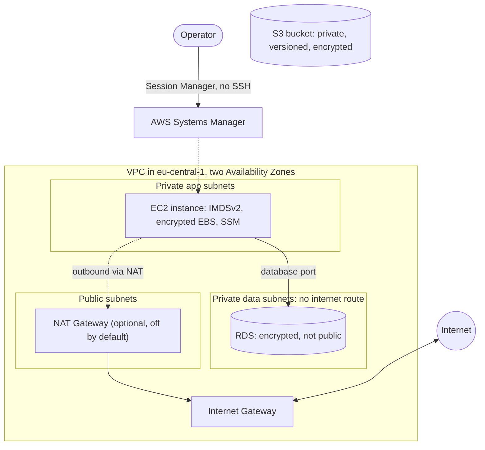

# reproducible-aws-infrastructure

[](LICENSE)
[](https://github.com/PavanPadamata/reproducible-aws-infrastructure/actions/workflows/checks.yml)

A reusable, reviewable AWS foundation written in Terraform: VPC, EC2, RDS,
S3 and IAM as separate modules, in `eu-central-1` (Frankfurt). The aim is
an environment that can be created, verified and destroyed repeatedly with
the same result, changed only through pull requests.

> **Status: work in progress.** The five modules, a `dev` environment and
> the bootstrap are on `main`, checked offline only: `terraform fmt`,
> `validate`, `tflint`, `terraform test` with a mock provider, and `trivy`.
> The GitHub Actions workflows are written and linted but have never run.
> The tables below say exactly what is built and what is planned. Nothing
> here has been applied to an AWS account yet.

## Status

| Area | State |
|------|-------|
| Provider configuration, default tags, version pinning | Built |
| Architecture docs, requirements, ADRs 0001-0011 | Built |
| `vpc`, `s3`, `iam`, `ec2`, `rds` modules | Built and tested offline, never applied |
| `envs/dev` calling `vpc`, `s3`, `ec2` and `rds` | Built, never planned or applied |
| `bootstrap/`: state bucket and CI roles (calls `s3` and `iam`) | Built and tested offline, never applied |
| S3 backend with native locking in `envs/dev` | Configured; no state exists yet because `envs/dev` has never been applied |
| CI: checks and plan on pull request, manual apply and destroy | Written and linted with `actionlint`, never run on GitHub |
| Load balancer, Auto Scaling, CloudTrail, CloudWatch alarms | Planned, beyond the initial scope ([ADR 0007](docs/adr/0007-initial-scope-five-modules.md)) |

## Target architecture

This is the design the modules are being built towards, not a description
of deployed infrastructure.



The database tier has no route to the internet at all, so isolation comes
from routing as well as from security groups. See
[docs/architecture.md](docs/architecture.md) for the full design and its
known limitations.

## Prerequisites

- An AWS account you control, and an IAM identity with permission to create
  the resources above
- Terraform at the version in [`.terraform-version`](.terraform-version)
  (the code requires `>= 1.11, < 2.0.0`)
- AWS CLI, configured for that account
- For contributing: `pre-commit`, `tflint`, `terraform-docs`, `gitleaks`
  (see [CONTRIBUTING.md](CONTRIBUTING.md))

## Quickstart

> **Never run.** `bootstrap/` and `envs/dev/` are written and checked
> offline, but neither has been planned or applied. This is the intended
> flow, to be confirmed and corrected after the first real run.

1. `cd bootstrap`, copy `terraform.tfvars.example` to `terraform.tfvars`,
   set `github_repository`, then `terraform init`, `plan` and `apply`. This
   creates the state bucket and the CI roles, uses local state, and is done
   once. See [bootstrap/README.md](bootstrap/README.md).
2. `cd envs/dev`, copy `backend.hcl.example` to `backend.hcl` and put the
   bucket name from step 1 in it. Both `backend.hcl` and `terraform.tfvars`
   are git-ignored.
3. Copy `terraform.tfvars.example` to `terraform.tfvars` and fill in your
   values.
4. `terraform init -backend-config=backend.hcl`, `terraform plan`, then
   `terraform apply`.

## Tear down

> **Planned and untested.** The order matters, because the state bucket
> holds the state that `envs/dev` needs to destroy itself.

1. In `envs/dev`: `terraform destroy`.
2. Empty the state bucket. It is versioned, so every object version and
   delete marker must be removed, not only the current objects.
3. In `bootstrap/`: `terraform destroy`. It fails while the bucket holds
   anything, because `force_destroy = false`
   ([ADR 0010](docs/adr/0010-state-bucket-from-the-s3-module-and-partial-backend.md)),
   so step 2 has to come first.

TODO(measure): record the date the full destroy path was run end to end,
and anything that did not clean up.

## CI/CD

Three GitHub Actions workflows in `.github/workflows/`. Only `checks.yml`
has run on GitHub. `plan.yml` was skipped because the repository variables
below are not set, and `apply.yml` has never run. Neither has authenticated
to AWS.

`main` is protected by a ruleset: changes go through a pull request, and the
`lint`, `security` and `test` jobs of `checks.yml` must pass before merge.
No approval is required, because the repository has one maintainer.

| Workflow | Runs | What it does | AWS access |
|----------|------|--------------|------------|
| `checks.yml` | every pull request and push to `main` | pre-commit hooks (fmt, validate, tflint, terraform-docs), `terraform test` in each module and `bootstrap/`, trivy on HIGH and CRITICAL, gitleaks over the full history | none |
| `plan.yml` | pull requests that touch `envs/` or `modules/` | `terraform plan` of `envs/dev`, shown in the job summary | read-only `ci-plan` role |
| `apply.yml` | started by hand, `main` only | `terraform apply` or `destroy` of `envs/dev`, behind a reviewer approval | `ci-apply` role |

Apply is manual on purpose: applying creates a NAT Gateway, an RDS instance
and an EC2 instance that bill by the hour, so it must not happen on every
merge ([ADR 0011](docs/adr/0011-plan-on-pull-request-apply-by-hand.md)).
Authentication uses OIDC; no AWS access keys are stored anywhere
([ADR 0006](docs/adr/0006-ci-cd-with-github-actions-and-oidc.md)).

**One-time setup, after `bootstrap/` has been applied.** The plan and apply
workflows do nothing until these exist:

1. Repository variables (Settings, Secrets and variables, Actions,
   Variables), taken from the `bootstrap/` outputs: `AWS_PLAN_ROLE_ARN`,
   `AWS_APPLY_ROLE_ARN` and `TF_STATE_BUCKET`. They are variables, not
   secrets.
2. An Environment named `dev` (Settings, Environments) with **required
   reviewers** and a **deployment branch rule limited to `main`**. The apply
   role trusts the Environment name, so without these two settings anything
   that names the Environment could assume it
   ([ADR 0009](docs/adr/0009-ci-roles-and-where-the-iam-module-runs.md)).

The repository is public, so workflow logs and job summaries are public.
Terraform hides sensitive values and the account ID is masked, but resource
names and IDs appear in plans.

## Cost drivers

These resources bill by the hour or by use whether or not anything is
happening. No prices are quoted here, because none have been measured.

| Driver | Why it costs |
|--------|--------------|
| NAT Gateway | Hourly charge plus per-GB data processing. Off by default in the VPC module. |
| RDS instance | Instance hours, plus storage and backups |
| EC2 instance | Instance hours, plus EBS volume |
| Public IPv4 addresses | Billed hourly, including the Elastic IP a NAT Gateway uses |
| VPC interface endpoints | Hourly per endpoint per AZ, if used instead of a NAT Gateway for SSM |

The environment is meant to be created for a working session and destroyed
afterwards ([ADR 0002](docs/adr/0002-ephemeral-environment.md)).

TODO(measure): cost of one apply-and-destroy session, from Cost Explorer.

## Modules

| Module | Purpose | State |
|--------|---------|-------|
| `vpc` | Two-AZ network with public, app and data tiers | Built, tested offline, never applied |
| `ec2` | Instance reachable through SSM, IMDSv2 required | Built, tested offline, never applied |
| `rds` | Private encrypted database, password in Secrets Manager | Built, tested offline, never applied |
| `s3` | Private bucket with versioning, encryption and TLS-only policy | Built, tested offline, never applied |
| `iam` | Least-privilege roles, GitHub OIDC provider and CI role | Built, tested offline, never applied. Called from `bootstrap/`, not `envs/dev` ([ADR 0009](docs/adr/0009-ci-roles-and-where-the-iam-module-runs.md)) |

## Repository layout

What exists today:

```
.
├── docs/
│   ├── adr/            architecture decision records
│   ├── architecture.md
│   ├── requirements.md
│   └── LEARNING.md     what was learned in each phase
├── bootstrap/          applied once: state bucket and CI roles (s3, iam)
├── envs/
│   └── dev/            root module: calls vpc, s3, ec2 and rds
├── modules/
│   ├── vpc/  s3/  iam/  ec2/  rds/    each with tests/ and a README
├── .pre-commit-config.yaml  .tflint.hcl  .terraform-docs.yml
└── .github/            workflows, dependabot config, CODEOWNERS, pull request template
```

## Decisions

| ADR | Decision |
|-----|----------|
| [0001](docs/adr/0001-use-terraform-for-all-infrastructure.md) | Terraform for all infrastructure |
| [0002](docs/adr/0002-ephemeral-environment.md) | Create and destroy per session, not run continuously |
| [0003](docs/adr/0003-remote-state-in-s3.md) | Remote state in S3 |
| [0004](docs/adr/0004-ssm-session-manager-instead-of-bastion.md) | Session Manager instead of a bastion host |
| [0005](docs/adr/0005-s3-native-locking-and-terraform-bootstrap.md) | S3 native locking, Terraform bootstrap |
| [0006](docs/adr/0006-ci-cd-with-github-actions-and-oidc.md) | GitHub Actions with OIDC |
| [0007](docs/adr/0007-initial-scope-five-modules.md) | Initial scope: five modules, one instance |
| [0008](docs/adr/0008-nat-gateway-opt-in-and-ssm-connectivity.md) | NAT Gateway is opt-in; SSM needs an outbound path |
| [0009](docs/adr/0009-ci-roles-and-where-the-iam-module-runs.md) | CI roles, and why the `iam` module runs from `bootstrap/` |
| [0010](docs/adr/0010-state-bucket-from-the-s3-module-and-partial-backend.md) | State bucket from the `s3` module; partial backend |
| [0011](docs/adr/0011-plan-on-pull-request-apply-by-hand.md) | Plan on pull request; apply and destroy started by hand |

## Contributing and security

Read [CONTRIBUTING.md](CONTRIBUTING.md) before opening a pull request.
Report security problems privately as described in [SECURITY.md](SECURITY.md).

## License

[MIT](LICENSE)
